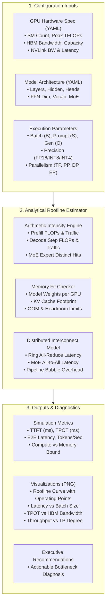
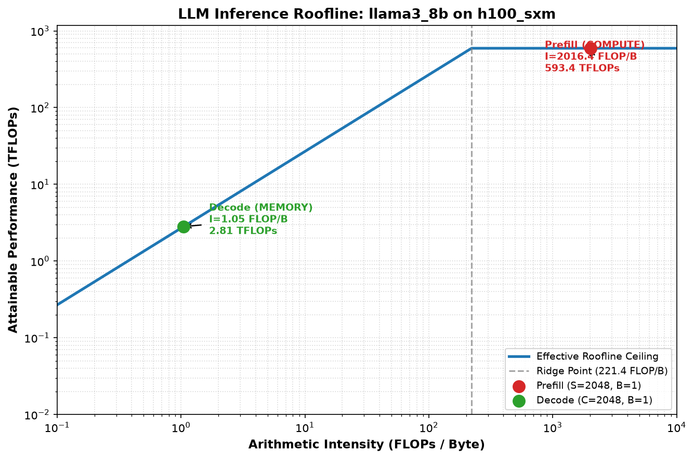
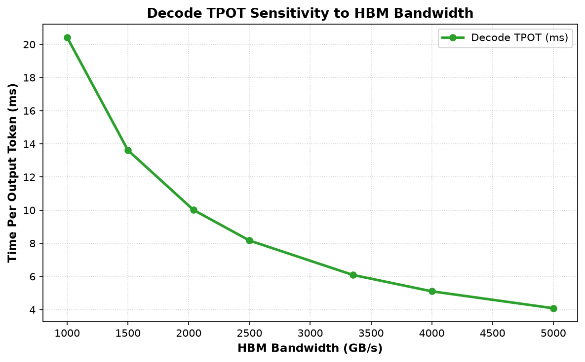
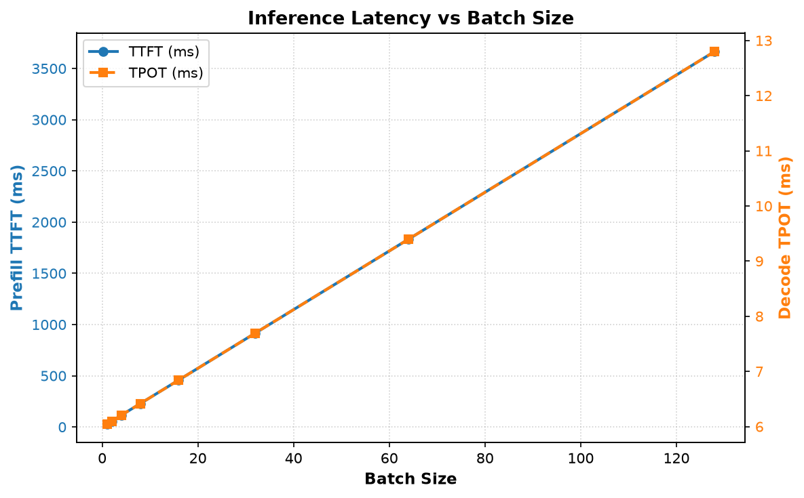
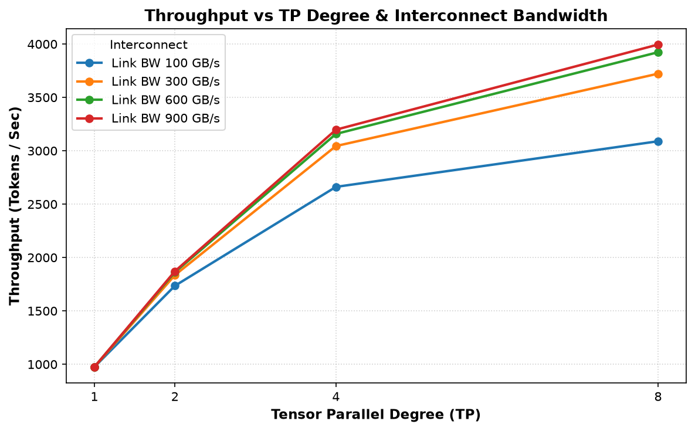
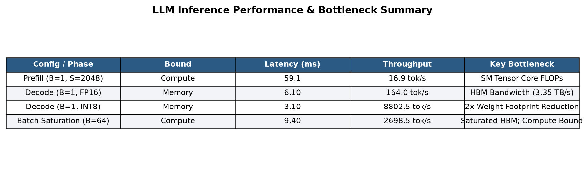

# llm-perf-simulator

[](https://github.com/Akash8959/llm-perf-simulator/actions/workflows/ci.yml)
[](https://opensource.org/licenses/MIT)
[](https://www.python.org/downloads/)

An analytical, roofline-style LLM inference performance simulator. Models latency, memory bandwidth bottlenecks, arithmetic intensity, distributed communication overheads, and hardware capacity across prefill and decode phases. **No GPU required.**

---

## Results at a Glance

| Metric / Scenario | Value | Regime / Key Takeaway |
| :--- | :--- | :--- |
| **H100 Hardware Ridge Point** | **221.4 FLOP/byte** | Hardware boundary dividing memory-bound from compute-bound |
| **Prefill Intensity (S=2048, B=1)** | **2,016 FLOP/byte** | **Compute-bound** ($\gg 221.4$); saturates GPU Tensor Cores |
| **Decode Intensity (C=2048, B=1)** | **1.05 FLOP/byte** | **Memory-bound** ($\ll 221.4$); limited by HBM read bandwidth |
| **H100 Baseline Decode TPOT** | **6.10 ms / token** | Baseline on H100 SXM5 ($3,350\text{ GB/s}$ HBM3, FP16) |
| **Decode TPOT with 2x HBM Bandwidth** | **3.05 ms / token** | **$2.0\times$ speedup (50% lower latency)** via memory scaling |
| **INT8 vs FP16 weight decode latency (B=4, C=1024)** | **3.10 ms vs 6.21 ms** | **50% lower latency** ($2.0\times$ speedup) & 50% memory savings |

---

## 1. Overview

Deploying and sizing Large Language Model (LLM) serving infrastructure requires balancing complex hardware-software interactions:
- **Prefill (Time to First Token / TTFT)** processes entire input prompt sequences concurrently, driving high arithmetic intensity and saturating GPU Tensor Core compute throughput.
- **Decode (Time Per Output Token / TPOT)** generates tokens sequentially step-by-step, reading full multi-billion parameter model weights and past Key-Value (KV) cache tensors for each token generated—making generation severely memory bandwidth-bound at small batch sizes.
- **Distributed Parallelism (TP, PP, DP, EP)** shards weights, KV cache, and computations across multiple GPUs, introducing ring all-reduce and all-to-all communication latency dependent on interconnect link bandwidth.

`llmsim` is a lightweight, rigorous simulator built purely on first-principles analytical roofline models.

---

## 2. Architecture



---

## 3. Mathematical Formulations & Worked Example

### 3.1 Notation
- $L$: Transformer layers
- $h$: Hidden dimension
- $n_h$: Query attention heads
- $n_{kv}$: Key/Value attention heads
- $d = h / n_h$: Head dimension
- $d_{ffn}$: Feed-forward intermediate dimension
- $V$: Vocabulary size
- $B$: Batch size
- $S$: Prompt sequence length
- $C$: Current context length during decode ($C \ge S$)
- $b_w, b_{kv}, b_{act}$: Bytes per parameter for weights, KV cache, and activations

### 3.2 Key Formulas

1. **Attention Parameters per Layer**:

   $$
   \text{Params}_{\text{attn}} = 2 \times h^2 + 2 \times h \times n_{kv} \times d
   $$

2. **SwiGLU FFN Parameters per Layer**:

   $$
   \text{Params}_{\text{ffn}} = 3 \times h \times d_{ffn}
   $$

   (For MoE with $E$ experts, top-$k$: Router $h \times E + E \times 3 \times h \times d_{ffn}$)

3. **KV Cache Footprint**:

   $$
   \text{KV Bytes} = 2 \times L \times n_{kv} \times d \times C \times B \times b_{kv}
   $$

4. **Prefill Phase (Prompt Evaluation)**:

   $$
   \text{FLOPs}_{\text{prefill}} = 2 \times \text{Active Params} \times B \times S + 4 \times L \times B \times S^2 \times h
   $$

   $$
   \text{Bytes}_{\text{prefill}} = \text{Active Params} \times b_w + 2 \times L \times B \times S \times h \times b_{act} + \text{KV Cache Write}
   $$

5. **Decode Step Phase (Single Generated Token)**:

   $$
   \text{FLOPs}_{\text{decode}} = 2 \times \text{Active Params} \times B + 4 \times L \times B \times C \times h
   $$

   $$
   \text{Bytes}_{\text{decode}} = \text{Weights Read} + \text{KV Cache Read}
   $$

   (For MoE: distinct experts hit $E_{\text{hit}} = E \times (1 - (1 - k/E)^B))

6. **Roofline Execution Latency**:

   $$
   t_{\text{latency}} = \max\left(\frac{\text{FLOPs}}{\text{Peak FLOPs} \times \eta_{\text{compute}}}, \frac{\text{Bytes}}{\text{HBM BW} \times \eta_{\text{memory}}}\right) + t_{\text{comm}}
   $$

   (Default efficiencies: $\eta_{\text{compute}} = 0.60$, $\eta_{\text{memory}} = 0.80$)

7. **Tensor Parallel Ring All-Reduce Latency**:

   $$
   t_{\text{ring}} = 2 \times \frac{N_{\text{TP}} - 1}{N_{\text{TP}}} \times \frac{B \times \text{tokens} \times h \times b_{act}}{\text{BW}_{\text{link}}} + (N_{\text{TP}} - 1) \times \tau_{\text{link}}
   $$

---

### 3.3 Worked Example: LLaMA-3-8B on NVIDIA H100 SXM5
- **Configuration**: Batch $B = 1$, Context $C = 2048$, Precision = FP16 ($b_w = 2, b_{kv} = 2$), H100 (989 TFLOPs FP16, 3350 GB/s HBM3).

| Metric | Calculation | Value |
| :--- | :--- | :--- |
| **Model Weights** | $2 \times 128256 \times 4096 + 32 \times (41.94\text{M} + 176.16\text{M})$ | 8,029,995,008 params (14.96 GB) |
| **KV Cache** | $2 \times 32 \times 8 \times 128 \times 2048 \times 1 \times 2$ | 268,435,456 bytes (256 MB) |
| **Effective Ridge Point** | $\frac{989 \times 10^{12} \times 0.60}{3350 \times 10^9 \times 0.80}$ | **221.42 FLOP/byte** |
| **Prefill FLOPs** | $2 \times 8.03\text{B} \times 1 \times 2048 + 4 \times 32 \times 1 \times 2048^2 \times 4096$ | 35.09 TFLOPs |
| **Prefill Bytes** | Weights (16.06 GB) + Act (1.07 GB) + KV (0.27 GB) | 17.40 GB |
| **Prefill Intensity** | $35.09 \times 10^{12} / 17.40 \times 10^9$ | **2,016.41 FLOP/byte** ($\gg 221.42 \implies$ **Compute-Bound**) |
| **Prefill TTFT** | $\max(35.09\text{T} / (989\text{T} \times 0.6), 17.40\text{GB} / (3350\text{GB/s} \times 0.8))$ | **59.13 ms** |
| **Decode Step FLOPs** | $2 \times 8.03\text{B} \times 1 + 4 \times 32 \times 1 \times 2048 \times 4096$ | 17.13 GFLOPs |
| **Decode Step Bytes** | Weights (16.06 GB) + KV Read (0.27 GB) | 16.33 GB |
| **Decode Intensity** | $17.13 \times 10^9 / 16.33 \times 10^9$ | **1.05 FLOP/byte** ($\ll 221.42 \implies$ **Memory-Bound**) |
| **Decode Step TPOT** | $\max(17.13\text{G} / (989\text{T} \times 0.6), 16.33\text{GB} / (3350\text{GB/s} \times 0.8))$ | **6.09 ms** |

---

## 4. Sample Results & Visualizations

Running the complete sweep suite (`examples/run_all_sweeps.py`) yields the following performance profiles in `results/`:

### 4.1 Roofline Chart
The log-log roofline curve plots operational intensity against attainable compute throughput, highlighting why prefill and decode reside on opposite sides of the hardware ridge point.



### 4.2 Decode TPOT vs HBM Bandwidth
Decode latency is strictly inverse to memory bandwidth. Doubling HBM bandwidth yields a ~50% reduction in token generation latency.



### 4.3 Latency vs Batch Size
Prefill latency scales linearly with batch size, while decode latency amortizes weight loads across sequences, increasing throughput until compute saturation.



### 4.4 Throughput vs Tensor Parallel Degree
Demonstrates the impact of interconnect bandwidth (PCIe vs NVLink) on multi-GPU scaling efficiency.



### 4.5 Performance Summary Table


---

## 5. Installation & Usage

### 5.1 Installation
Requires Python 3.10+:

```bash
git clone https://github.com/Akash8959/llm-perf-simulator.git
cd llm-perf-simulator
python -m venv .venv
source .venv/bin/activate  # On Windows: .venv\Scripts\activate
pip install -r requirements.txt -e .
```

### 5.2 Command-Line Interface (CLI)

Run single configuration simulation:
```bash
python -m llmsim.cli \
  --hardware configs/hardware/h100_sxm.yaml \
  --model configs/models/llama3_8b.yaml \
  --batch 16 \
  --prompt-len 2048 \
  --output-len 256 \
  --tp 2 \
  --quant int8
```

Run a parametric sweep and generate visualizations:
```bash
python -m llmsim.cli \
  --hardware configs/hardware/h100_sxm.yaml \
  --model configs/models/llama3_8b.yaml \
  --sweep hbm \
  --plot \
  --out-dir results
```

Run all sweeps and generate CSVs and plots:
```bash
python examples/run_all_sweeps.py
```

### 5.3 Python API

```python
from llmsim.hardware import load_gpu
from llmsim.model import load_model
from llmsim.simulator import simulate
from llmsim.parallelism import ParallelConfig

gpu = load_gpu("configs/hardware/h100_sxm.yaml")
model = load_model("configs/models/llama3_8b.yaml")

res = simulate(
    gpu=gpu,
    model=model,
    batch=8,
    prompt_len=1024,
    output_len=128,
    parallel=ParallelConfig(tp=2),
    weight_precision="int8",
    kv_precision="fp16",
)

print(f"TTFT: {res.ttft * 1e3:.2f} ms")
print(f"TPOT: {res.tpot * 1e3:.2f} ms")
print(f"Throughput: {res.tokens_per_sec:.1f} tokens/sec")
print(f"Memory: {res.memory_per_gpu_gb:.2f} GB (Fits: {not res.is_oom})")
```

---

## 6. Adding New Hardware or Model Configurations

### Adding a GPU
Create a new YAML file in `configs/hardware/<gpu_name>.yaml`:
```yaml
# Hardware Configuration: Custom Accelerator
# Source: Datasheet specification URL
name: "custom_gpu"
sm_count: 128
peak_tflops_fp16: 800.0
peak_tflops_bf16: 800.0
peak_tflops_fp8: 1600.0
peak_tflops_int8: 1600.0
hbm_bandwidth_gbps: 3000.0
memory_capacity_gb: 96.0
l2_cache_mb: 64.0
interconnect_bandwidth_gbps: 800.0
interconnect_latency_us: 2.5
```

### Adding a Model
Create a new YAML file in `configs/models/<model_name>.yaml`:
```yaml
# Model Configuration: Custom Transformer
# Source: Architecture paper citation
name: "custom_model"
layers: 32
hidden: 4096
heads: 32
kv_heads: 8           # Set < heads for Grouped-Query Attention (GQA)
ffn_dim: 14336
vocab: 128256
num_experts: 1        # > 1 for MoE architectures
top_k: 1              # Active routed experts per token
shared_experts: 0     # Shared always-active experts
```

---

## 7. Assumptions & Limitations

1. **Empirical Efficiency Factors**: Default hardware efficiencies ($\eta_{\text{compute}} = 0.60$, $\eta_{\text{memory}} = 0.80$) represent sustained hardware utilization. Real workloads vary based on sequence padding and kernel tuning.
2. **No Kernel-Level Overhead**: Assumes idealized memory coalescing and tensor core execution. Ignores CUDA kernel launch latencies (~5-10 $\mu$s per kernel), quantization dequantization runtime overhead, and on-chip SRAM register spill.
3. **No Dynamic Scheduling or Queueing**: Models synchronous inference for a static batch. Does not model continuous batching (iteration-level scheduling) or request arrival Poisson distributions.
4. **Compute / Communication Overlap Ignored**: Assumes sequential execution where communication adds linearly to compute/memory latency ($t = \max(t_{\text{comp}}, t_{\text{mem}}) + t_{\text{comm}}$). In advanced frameworks, All-Reduce operations can partially overlap with layer computation.
5. **Validation & Modeling Scope**: All reported figures are analytical, first-principles roofline estimates rather than measured empirical benchmarks. Real-world systems running production inference frameworks (such as vLLM, TensorRT-LLM, or TGI) will exhibit higher latencies due to CUDA kernel launch overheads, host runtime scheduling, non-contiguous memory allocations, and driver synchronization.

---

## 8. Extension Ideas

- **Speculative Decoding**: Analytical speedup modeling based on small draft model acceptance rate distributions.
- **Prefix Caching & Context Sharing**: Accounting for shared system prompt KV cache reuse across conversations.
- **Microscaling / FP4 Precision**: Adding Blackwell / Hopper FP4 quantization and sub-byte memory traffic calculations.
- **Pipeline Bubble Scheduling**: Simulating 1F1B and Zero-Bubble pipeline schedules with activation memory staging.

---

## 9. License

This project is licensed under the [MIT License](LICENSE).
